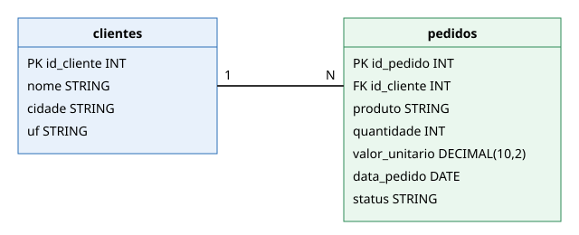

# Contextualização do Trabalho

Trabalho 2 da disciplina **Engenharia de Dados** (Engenharia de Software – 5ª fase – SATC), professor Jorge Luiz da Silva.
É um **complemento do trabalho 1** ([Delta Lake e Apache Iceberg](https://thomasjefersonm.github.io/pesquisadados/)), em repositório separado.

## Objetivo
Construir um pipeline que **extrai** os dados de um banco relacional (SQL Server), **grava** em um *object storage* (MinIO) e **converte** para o formato **Delta Lake**, repetindo depois os comandos **INSERT, UPDATE e DELETE** do trabalho 1.

## Cenário e conjunto de dados
Mesma loja virtual fictícia do trabalho 1, agora hospedada em um banco **SQL Server** (`LojaDB`). Os dados foram **criados pelo grupo** e estão em `data/`:

| Arquivo | Conteúdo |
|---|---|
| `data/clientes.csv` | 4 clientes |
| `data/pedidos.csv` | 5 pedidos |

### Modelo ER


Um cliente possui vários pedidos (relação 1:N por `id_cliente`).

### DDL (SQL Server)
```sql
CREATE TABLE clientes (
    id_cliente INT PRIMARY KEY,
    nome       NVARCHAR(100) NOT NULL,
    cidade     NVARCHAR(100),
    uf         CHAR(2)
);

CREATE TABLE pedidos (
    id_pedido      INT PRIMARY KEY,
    id_cliente     INT NOT NULL,
    produto        NVARCHAR(100) NOT NULL,
    quantidade     INT NOT NULL,
    valor_unitario DECIMAL(10,2) NOT NULL,
    data_pedido    DATE NOT NULL,
    status         NVARCHAR(20) NOT NULL,
    CONSTRAINT fk_pedidos_clientes
        FOREIGN KEY (id_cliente) REFERENCES clientes (id_cliente)
);
```

## Arquitetura
```
SQL Server (LojaDB)  ──▶  MinIO: landing-zone/ (CSV)  ──▶  MinIO: bronze/ (Delta Lake)
```

## Notebooks
Executados em ordem, na pasta `notebook/`: `00_setup_sqlserver`, `01_sqlserver_to_minio_csv`, `02_csv_to_delta`, `03_dml_delta` e `04_gerenciadas_vs_nao_gerenciadas`.
